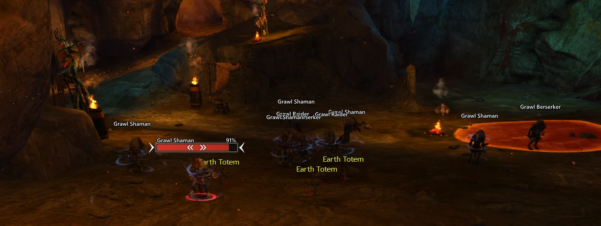
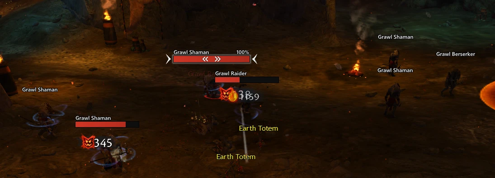
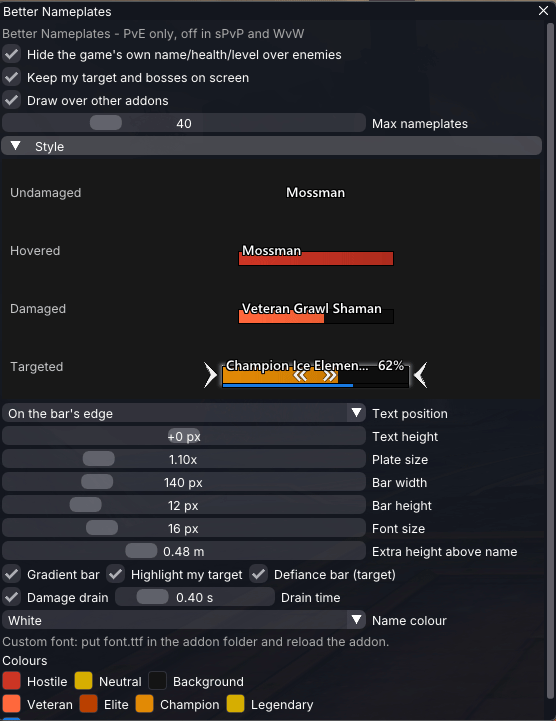

# Better Nameplates

**Clean, readable enemy nameplates for Guild Wars 2.** A [Raidcore Nexus](https://raidcore.gg/Nexus) addon.

Better Nameplates replaces the game's own enemy name and health labels with compact plates: a name, a health bar
in the enemy's rank colour, and nothing you don't need until you need it.

Better Nameplates reads game memory to find enemies, and hides the game's own enemy labels through the game's own
interface code. It does not change game state, send input or automate anything. See [Addon policy](#addon-policy).

## How it behaves

- **Names until a fight starts.** An enemy at full health shows only its name. The bar appears as soon as it
  takes damage, while you hover it with the mouse, and while it is your target.
- **Rank at a glance.** Bars are coloured by rank: normal, veteran, elite, champion and legendary each have
  their own colour.
- **Your target stands out.** The target's plate grows slightly and gets markers and a soft outline, and it
  is the only plate that shows a health percentage and a break bar.
- **Damage you can see.** Lost health turns white and shrinks away, so big hits read clearly.
- **Plates stay where they belong.** They hide behind walls and terrain, behind open game windows and pop-ups,
  and for enemies that are not targetable yet (still spawning and similar).
- **Your target is never lost.** Its plate stays on screen even when the enemy is off screen or behind the
  camera.
- **Neutral creatures stay quiet.** A neutral enemy keeps the game's own label until something hurts it.

Plates are drawn about as far as the game draws its own enemy labels.

## Settings

Click the Better Nameplates icon in the Nexus quick-access bar (top left of the screen) to open the settings. The
**Style** section has a live preview showing undamaged, hovered, damaged and targeted plates, so you can see
each change as you make it.

You can change:

- text position: above the bar, on the bar's top edge or centred in it, and the text's height from there
- plate size, bar width and height, font size and the plate's height above the enemy
- gradient bar, target highlight, damage drain speed and the target's break bar
- the name colour: white, a colour of your choice, or the bar's colour
- every rank and bar colour

To use your own font, put `font.ttf` (or `font.otf`) in `addons/BetterNameplates/` and reload the addon.

## Installation

1. Install [Raidcore Nexus](https://raidcore.gg/Nexus).
2. Download `BetterNameplates.dll` from the [latest release](https://github.com/arcklep/better-nameplates/releases/latest)
   and put it in `Guild Wars 2/addons/`.
3. Start the game and load Better Nameplates from the Nexus addon list.

Nexus checks this repository for new releases and offers updates on its own.

Better Nameplates was called gw2plates in version 1.0.0. If you have that installed, delete `gw2plates.dll`
before adding `BetterNameplates.dll`; your settings carry over.

Better Nameplates shares its internals with Joycat UI, so load only one of the two.

## Addon policy

ArenaNet's third-party program policy allows addons that do not give a gameplay advantage over other players.

- Better Nameplates shows only information the game already shows you: names, health, rank and break bars.
- It reads game memory to find that information. The one thing it changes is the visibility of the game's
  own enemy labels, which it hides through the game's own interface function, the same way the game hides
  them itself.
- It never sends input to the game, never acts for you and never automates anything.
- It is switched off completely in structured PvP and World vs. World.

## License

Better Nameplates is free to use but closed source since it performs memory reading. See [LICENSE](LICENSE). Third-party software it includes is
listed in [THIRD-PARTY-NOTICES.txt](THIRD-PARTY-NOTICES.txt).
