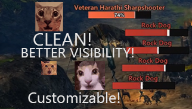
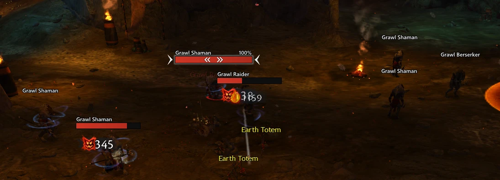

# Better Nameplates

**Clean, readable nameplates for Guild Wars 2.** A [Raidcore Nexus](https://raidcore.gg/Nexus) addon.

## Features

**Enemies**
- Just the name until a fight starts, the bar shows up once they take damage or you hover/target them
- Bars coloured by rank (normal, veteran, elite, champion, legendary)
- Your target's plate grows and shows health % and the break bar
- Click a plate to target it
- Nameplate SCT: your damage pops up from the enemy's plate

**Friendly**
- Plates for players, NPCs, townsfolk, vendors and pets, shown wherever the game shows their names
- Titles, guild tags and mastery level
- Party, squad and subgroup colours, with their own plate settings if you want them
- Plate colours follow the game's own name colours

**Everywhere**
- Target markers, commander tags and squad markers (works with Commander Tag Accessibility)
- Drag the bar, name and markers wherever you like on the Plate layout pages
- Overlapping plates can push each other apart
- Plates hide behind walls and game windows
- Works with NVIDIA Smooth Motion: with ArcDPS or RealTime API loaded, plates stay locked to what they belong to
- Any language: addon font, the game's font, or your own `font.ttf`/`font.otf` in `addons/BetterNameplates/`

Settings are under the Better Nameplates icon in the Nexus quick-access bar.

## Installation

1. Install [Raidcore Nexus](https://raidcore.gg/Nexus).
2. Grab `BetterNameplates.dll` from the [latest release](https://github.com/arcklep/better-nameplates/releases/latest)
   and drop it in `Guild Wars 2/addons/`.
3. Start the game and load Better Nameplates from the Nexus addon list.

Nexus picks up new releases on its own. If it updates while you're playing, restart the game.

## Addon policy

ArenaNet allows addons that don't give a gameplay advantage, and this one sticks to that:

- It only shows what the game already shows you: names, health, ranks, titles and markers.
- It reads game memory to find that info and hides the game's own name labels through the game's own function.
  Clicking a plate targets it, same as clicking the character.
- It never acts on its own or automates anything.
- It's switched off in structured PvP and World vs. World.

## License

Free to use, closed source since it reads game memory. See [LICENSE](LICENSE). Third-party software it includes is
listed in [THIRD-PARTY-NOTICES.txt](THIRD-PARTY-NOTICES.txt).
