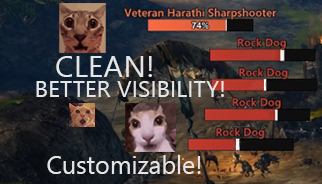

# Better Nameplates

**Clean, readable enemy nameplates for Guild Wars 2.** A [Raidcore Nexus](https://raidcore.gg/Nexus) addon.

## Features

- **Names until a fight starts.** Undamaged enemies show only their name; the bar appears once they take damage,
  when you hover them or target them.
- **Rank at a glance.** Bars are coloured by rank: normal, veteran, elite, champion and legendary.
- **Your target stands out.** Its plate grows, shows health percentage and the break bar, and stays on screen.
- **Click a plate to target** its enemy.
- **Keep plates apart.** Overlapping plates push each other upward (optional).
- **Nameplate SCT.** Your damage pops up from the enemy's plate, with its own font and style options.
- **Target markers.** Your Personal and Call Target markers show on the plates.
- **Plates stay where they belong.** Hidden behind walls, open game windows and conversation windows.
- **NVIDIA Smooth Motion.** With ArcDPS loaded, plates are drawn in every frame and stay locked to the mobs.
- **Any language.** Pick the addon font, the game's font or your own `font.ttf`/`font.otf` in
  `addons/BetterNameplates/`.

## Settings

Click the Better Nameplates icon in the Nexus quick-access bar. Pages for nameplates, fonts, target markers and SCT,
with a live preview. Change plate size, bar and text layout, colours per rank, which plates show and much more.

## Installation

1. Install [Raidcore Nexus](https://raidcore.gg/Nexus).
2. Download `BetterNameplates.dll` from the [latest release](https://github.com/arcklep/better-nameplates/releases/latest)
   and put it in `Guild Wars 2/addons/`.
3. Start the game and load Better Nameplates from the Nexus addon list.

Nexus offers new releases on its own. After an update while the game is running, restart the game.

## Addon policy

ArenaNet's third-party program policy allows addons that do not give a gameplay advantage over other players.

- Better Nameplates shows only what the game already shows you: names, health, rank and break bars.
- It reads game memory to find that information and hides the game's own enemy labels through the game's own
  interface function. Clicking a plate targets that enemy, like clicking the enemy itself.
- It never acts on its own and never automates anything.
- It is switched off in structured PvP and World vs. World.

## License

Free to use, closed source since it reads game memory. See [LICENSE](LICENSE). Third-party software it includes is
listed in [THIRD-PARTY-NOTICES.txt](THIRD-PARTY-NOTICES.txt).
